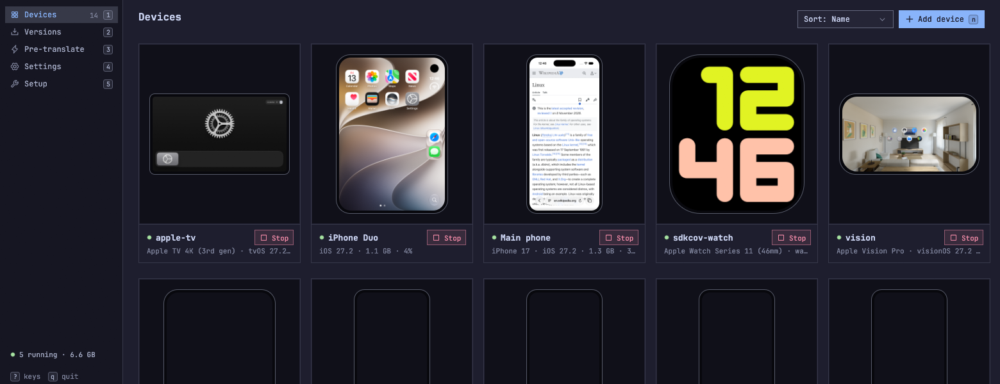
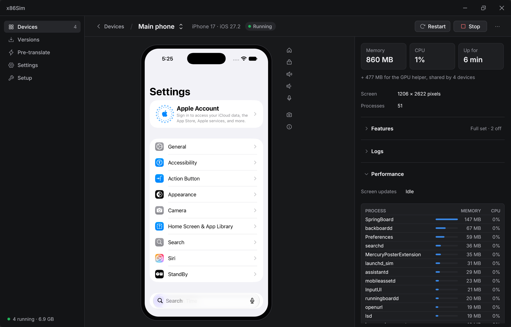
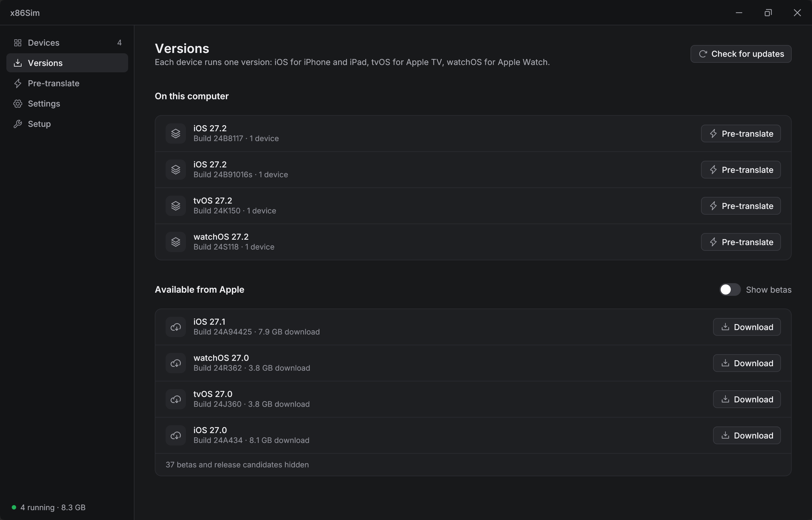
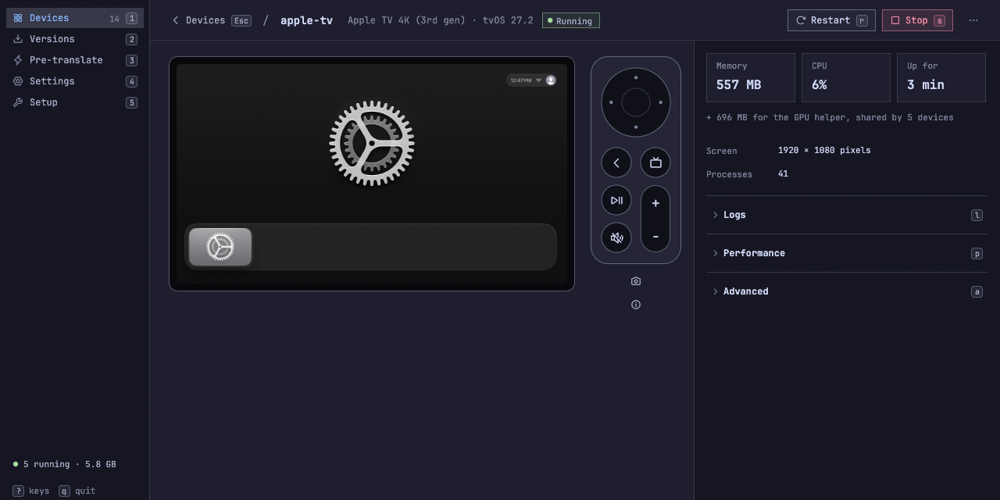
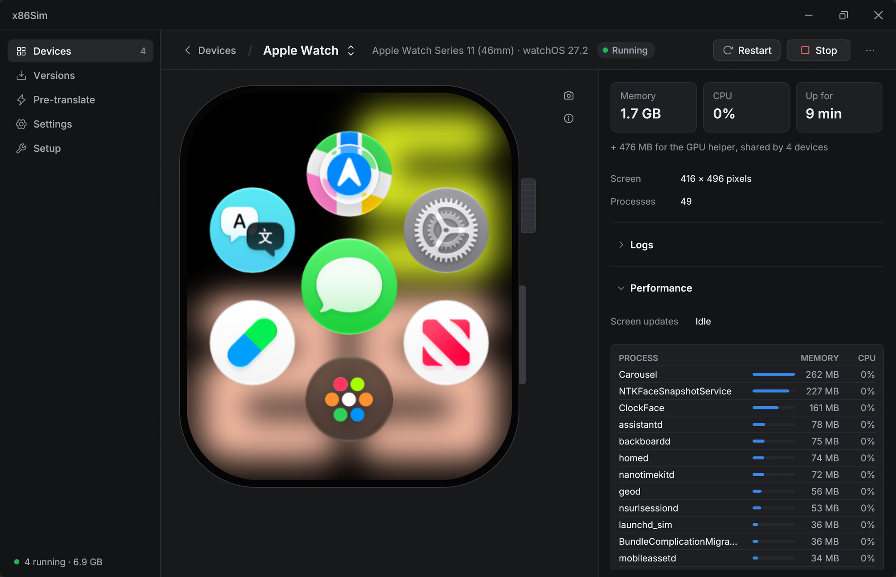

<div align="center">

# x86Sim

**Apple's iOS, iPadOS, tvOS and watchOS simulators on x86-64 Linux.**

[](https://github.com/x86sim/x86sim/releases/latest)
[](LICENSE)

[Download](https://github.com/x86sim/x86sim/releases/latest) · [Quick start](#quick-start) · [Usage](#usage) · [Architecture](docs/ARCHITECTURE.md) · [Developing](docs/DEVELOPMENT.md)



</div>

## About

Apple ships its device simulators only for Macs. x86Sim runs the same arm64 simulator runtimes, unmodified, on an
ordinary x86-64 Linux PC. It downloads a runtime from Apple onto your machine, runs it on a macOS-compatible system
layer, translates its arm64 code to x86-64 and draws its Metal graphics with Vulkan.

It comes with a desktop launcher, a `simctl`-style command line and an MCP server, so devices can be used by hand,
from scripts or by an AI agent. No Mac and no Apple ID are needed.

## Features

**Devices**

- iPhone, iPad, Apple TV and Apple Watch: 80 device models, including the dual-screen iPhone Duo, which folds and
  unfolds.
- Several devices at once. Each runs in its own container with its own apps, data and settings; starting or stopping
  one leaves the others alone.
- The stock system apps of each runtime, such as Settings, Safari, Photos, Files, Maps and Health.

**Apps**

- Install, launch, terminate and uninstall your own apps: arm64 iOS-simulator builds, the kind Xcode produces for
  the simulator.
- Launch with arguments and environment variables, stream an app's stdout, stderr or `os_log`, or have it wait for a
  debugger.
- Find an app's bundle, data and app-group containers as ordinary Linux paths.

**Graphics and input**

- GPU rendering: Metal is translated to Vulkan for the system's render server and for apps. Software rendering is
  available as a fallback.
- Touch with the mouse: tap, swipe, edge gestures, pinch and two-finger scroll. Your keyboard types into the device,
  and Ctrl+V pastes from the Linux clipboard.
- Home, lock and volume buttons; an on-screen Siri Remote for Apple TV; a Digital Crown and side button for Apple
  Watch.

**Performance and memory**

- arm64 code is translated just in time and kept in a persistent cache.
- Pre-translation builds an ahead-of-time image for a runtime, once, so boots and app launches are fast. It updates
  incrementally when something changes.
- Feature sets: turn off the parts of the system a device doesn't need (Siri, Maps, Wallet, widgets, the live
  wallpaper and others), individually or with the Full, Lean and Minimal presets. Each one lists its memory cost.
- An optional memory cap per device, and a clean-up service that reclaims idle background processes.
- Live memory, CPU and per-process figures for every device.

**Developer tools**

- Simulated push notifications, simulated location (a point, a route between waypoints or one of Apple's scenarios),
  opening URLs, and adding photos and videos to the Photos library.
- Screenshots and H.264 / HEVC video recording.
- Scripted input: tap, swipe, pinch, type, hardware keys, Digital Crown.
- Per-service logs for every device, with filtering.

**Setup and updates**

- One AppImage. A setup page checks the computer, downloads a runtime from Apple, pre-translates it and creates the
  first device.
- No root where unprivileged user namespaces are available.
- Runtimes are managed on a Versions page: download, resume and remove iOS, tvOS and watchOS versions.
- The AppImage updates itself, on a stable or a pre-release channel.

<table>
<tr>
<td width="50%"></td>
<td width="50%"></td>
</tr>
<tr>
<td align="center"><sub>A device with its memory, CPU and processes</sub></td>
<td align="center"><sub>Runtimes, downloaded from Apple</sub></td>
</tr>
<tr>
<td width="50%"></td>
<td width="50%"></td>
</tr>
<tr>
<td align="center"><sub>Apple TV</sub></td>
<td align="center"><sub>Apple Watch</sub></td>
</tr>
</table>

## Quick start

1. Download `x86sim-*-x86_64.AppImage` from the [latest release](https://github.com/x86sim/x86sim/releases/latest).
2. Make it executable and run it:
   ```sh
   chmod +x x86sim-*-x86_64.AppImage
   ./x86sim-*-x86_64.AppImage
   ```
3. Follow the **Setup** page. It checks your computer, prepares the simulator host, downloads iOS 27.2 from Apple
   (about 8 GB), pre-translates it and creates your first device.

Where unprivileged user namespaces are available, nothing is installed outside your home directory and no root is
needed. Where they are blocked (Ubuntu's default, for example), Setup asks for your password once to install the
simulator host under `/opt/x86sim`.

For an Apple TV or an Apple Watch, download tvOS or watchOS on the **Versions** page, then choose **Add device**.

## Requirements

| | |
|---|---|
| **OS** | x86-64 Linux with glibc 2.39 or newer: Ubuntu 24.04+, Debian 13, Fedora 39+, Arch and derivatives |
| **CPU** | x86-64 with SSE4.1, POPCNT and CX16 |
| **GPU** | A Vulkan GPU and driver: NVIDIA (proprietary driver) or Mesa (RADV, ANV). Without one, rendering falls back to software |
| **Memory** | 8 GB minimum, 16 GB recommended |
| **Disk** | 45 GB free while a runtime downloads and unpacks |
| **Kernel** | overlayfs; Linux 6.11 or newer is a little faster |

Setup also looks for a few common programs (`python3`, `curl`, `openssl`, `systemd-run`) and tells you if one is
missing. Everything else is inside the AppImage.

## Supported devices and versions

| Device | Runtime | Models | Input |
|---|---|---|---|
| **iPhone** | iOS 27 | 34, from iPhone 11 to iPhone 18 Pro Max, and the iPhone Duo | Touch and gestures, keyboard, Home, lock and volume |
| **iPad** | iOS 27 (iPadOS) | 29: iPad, iPad mini, iPad Air, iPad Pro | Touch and gestures, keyboard, Home, lock and volume |
| **Apple TV** | tvOS 27 | 4: Apple TV 4K, 2nd and 3rd generation | Siri Remote on screen; arrow keys, Return and Escape |
| **Apple Watch** | watchOS 27 | 13: Series 9 to 12, SE 3, Ultra 2 to 4 | Touch, Digital Crown, side button |

Runtimes come straight from Apple's own catalogue, the one Xcode reads. Each copy is downloaded on your machine and
is never redistributed. iOS 27.2 is the default; the Versions page lists the other 27.x releases Apple offers,
with betas if you ask for them.

## Usage

### Launcher

The launcher is what the AppImage opens. Its pages:

- **Devices**: every device as a card with a live screen. Start, stop, restart, add, rename and remove devices, or
  open one in its own window. A device's page has its screen and buttons, its feature toggles, memory, CPU and
  processes, and its logs.
- **Versions**: the runtimes on this computer and those available from Apple.
- **Pre-translate**: build or update the ahead-of-time image for a runtime, and see what it takes on disk.
- **Settings**: graphics (GPU or software), screen scaling, memory cap and clean-up, disk use, and updates.
- **Setup**: the first-run steps, which stay available afterwards as a check of the computer.

Closing the launcher leaves running devices running.

### Command line

`x86sim` follows `xcrun simctl` where there is an equivalent. From the AppImage it is
`./x86sim-*.AppImage x86sim <command>`; in a checkout it is `cli/x86sim`.

```sh
x86sim device models                          # the models a device can be
x86sim device create --model "iPhone 17 Pro" work
x86sim runtime list all                       # runtimes in Apple's catalogue

x86sim install MyApp.app                      # an arm64 iOS-simulator build
x86sim launch --console com.example.myapp -arg value
x86sim terminate com.example.myapp
x86sim listapps --json
x86sim get_app_container com.example.myapp data

x86sim openurl https://example.com
x86sim push com.example.myapp payload.json    # simulated remote notification
x86sim location set 48.8584,2.2945            # also: routes and scenarios
x86sim addmedia photo.jpg clip.mov
x86sim log stream --app com.example.myapp

x86sim tap 200 400                            # also: swipe, pinch, type, key, home, lock, crown
x86sim screenshot shot.png
x86sim io recordVideo --secs 10 out.mp4
```

`x86sim help` lists every command. A second tool, `x86sim-aot` (`./x86sim-*.AppImage aot`), starts and stops
devices, edits feature sets and builds the pre-translated image from a terminal.

### MCP server

`x86sim-mcp` is a [Model Context Protocol](https://modelcontextprotocol.io) server over stdio for AI agents and
other MCP clients. Its tools list, create, start, stop and restart devices, fold the iPhone Duo, read and change
feature sets, install, launch, list and uninstall apps, and report the state of the pre-translated image.

```sh
claude mcp add x86sim -- /path/to/x86sim.AppImage mcp      # AppImage
claude mcp add x86sim -- /path/to/x86sim-mcp               # built from source
```

Screenshots, input and the other developer tools are on the command line, which an agent can call as well.

## How it works

- **[Darling](https://github.com/darlinghq/darling)** provides the macOS-compatible system layer: the Mach-O loader, XNU system
  call and Mach IPC emulation, and one container per device. x86Sim's fork extends it for what the simulator
  runtimes need.
- **[dynarmic](https://github.com/azahar-emu/dynarmic)** translates the runtime's arm64 code to x86-64, just in time
  or ahead of time into a pre-translated image. The lowest system libraries stay native x86-64 code, so system calls
  are not translated.
- **[metal2vulkan](https://github.com/steelbrain/metal2vulkan)** runs Metal on Vulkan. The runtime's own Metal
  implementation talks to a native Linux process, `mtlvk`, with buffers and textures shared rather than copied.
- **Stand-ins for the Mac host.** Everything CoreSimulator and macOS would provide around a runtime is replaced by
  small programs: `simfb` for the display, `simhid` for input, and others for cross-process surfaces, DNS, network
  state and host file services.

[ARCHITECTURE.md](docs/ARCHITECTURE.md) describes each part, [METAL.md](docs/METAL.md) the graphics path, and
[docs/protocols](docs/protocols) the wire formats.

## Building from source

```sh
git clone --recursive https://github.com/x86sim/x86sim.git
cd x86sim
cp x86sim.env.example x86sim.env

make darling-install                             # Darling; asks for sudo (bin/darling is setuid root)
make mtlvk                                       # Metal on Vulkan
linux/arm64jit/install.sh                        # the arm64 translator, installed into Darling
(cd tools/launcher && cargo build --release)     # launcher, x86sim-aot, x86sim-mcp
```

[DEVELOPMENT.md](docs/DEVELOPMENT.md) covers the build dependencies, fetching runtimes, the repository layout and
day-to-day use. The simulator-side binaries are committed, so no Mac is needed to build or run. Release AppImages
are built by `build/release/` and GitHub Actions; see [RELEASE.md](docs/RELEASE.md).

## Status and limitations

x86Sim is young software. The runtimes boot to their home screens, stock and third-party apps run, and the tools
above work. These are the known gaps:

- **Apps** must be arm64 simulator builds. Device builds, such as App Store apps, do not run on a simulator runtime.
- **Maps** shows no map tiles: the map data comes from a Mac and is not part of a release.
- **Audio** is experimental and off by default.
- **Sensors and accessories**: no rotation, shake, accelerometer, Apple Pencil or game controllers.
- **Pairing** an Apple Watch with an iPhone is not supported.
- **Networking**: ordinary DNS and sockets work; Bonjour (multicast DNS) does not.
- **Sandboxing**: simulator processes are not sandboxed.
- **System logging**: the unified log daemon does not run. `x86sim log stream` covers one app or process at a time.

[WORKAROUNDS.md](docs/WORKAROUNDS.md) lists everything that is approximated and what a faithful version would need.

## License and credits

x86Sim is free software, licensed under the [GNU General Public License v3.0 or later](LICENSE). Bundled components
keep their own licenses; see [NOTICE](NOTICE).

x86Sim builds on:

- [Darling](https://github.com/darlinghq/darling), used through the [x86sim fork](https://github.com/x86sim/darling)
- [dynarmic](https://github.com/azahar-emu/dynarmic), used through the [x86sim fork](https://github.com/x86sim/dynarmic)
- [metal2vulkan](https://github.com/steelbrain/metal2vulkan), used through the [x86sim fork](https://github.com/x86sim/metal2vulkan)
- [ipsw](https://github.com/blacktop/ipsw), [7-Zip](https://www.7-zip.org),
  [dnspython](https://github.com/rthalley/dnspython), astcenc and lzfse

Each fork carries its changes on a branch named `x86sim`.

Apple's simulator runtimes, SDKs and Xcode are not included and are never redistributed. Apple, iPhone, iPad, iOS,
Xcode and Metal are trademarks of Apple Inc. x86Sim is not affiliated with or endorsed by Apple.
